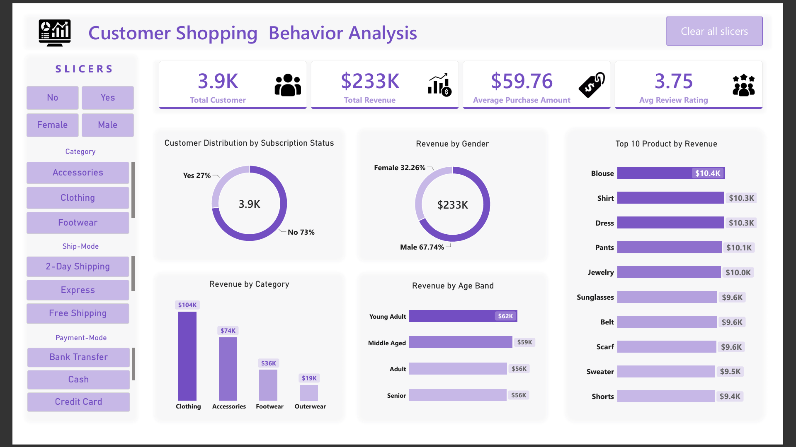
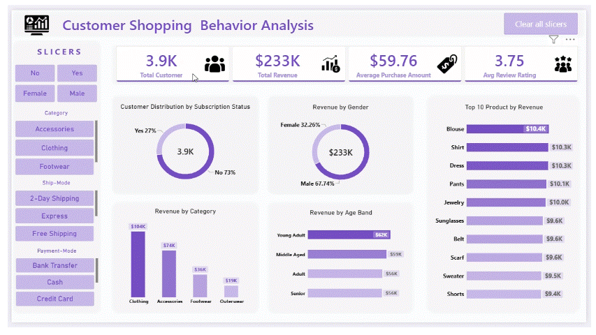

## Overview
Customer Shopping Behavior End -to- End Analysis is an end-to-end data analytics project focused on understanding customer purchasing patterns, revenue drivers, subscription behavior, product performance, and demographic trends within a retail environment.

## Dashboard Animated view

The project demonstrates a complete analytics workflow starting from raw CSV data preparation to SQL-based business analysis and finally interactive business intelligence reporting using Power BI.

# Analytics Workflow
Raw CSV Dataset → Data Cleaning & Transformation (Python) → Exploratory Data Analysis (PostgreSQL) → Interactive Dashboard Development (Power BI)

Business Objective
Retail businesses generate significant customer transaction data but often face challenges in converting this data into actionable insights.

This project aims to answer important business questions:

Which customer groups generate the highest revenue?
How does subscription status influence customer spending?
Which products receive the highest customer ratings?
Which products are most popular within their categories?
How do discounts impact purchasing behavior?
Which shipping methods are associated with higher purchase values?
What are the characteristics of repeat customers?
Which age groups contribute the most revenue?

# Technology Stack
Technology	Purpose
Python	Data Cleaning & Transformation
Jupyter Notebook	Data Processing Environment
Pandas	Data Manipulation
PostgreSQL	Exploratory Data Analysis
SQL	Business Query Analysis
Power BI	Dashboard Development & Visualization

# Data Preparation
The raw dataset was processed in Jupyter Notebook using Python to ensure analytical accuracy and consistency.

Data Cleaning Activities
Data quality assessment
Missing value handling
Duplicate record verification
Data type conversion
Feature engineering
Data validation checks
Preparation of analysis-ready dataset

# SQL Business Analysis
After cleaning, the dataset was imported into PostgreSQL where multiple business-focused analytical queries were executed.

1. Revenue Analysis by Gender
Analyzed total revenue contribution from different customer genders to identify the highest revenue-generating segment.

2. Discount & Spending Analysis
Used subqueries to identify customers who received discounts while spending above the overall average purchase amount.

3. Product Rating Analysis
Ranked products based on average review ratings to identify the highest-rated products.

4. Shipping Analysis
Compared average purchase values between Standard and Express shipping methods.

5. Subscription Analysis
Evaluated customer count, average spending, and revenue contribution for subscribers and non-subscribers.

6. Discount Dependency Analysis
Measured the percentage of purchases completed with discounts applied across products.

7. Customer Segmentation Analysis
Classified customers into:

New Customers
Returning Customers
Loyal Customers
based on previous purchase history.

8. Product Popularity Analysis
Applied SQL Window Functions to determine the Top 3 most purchased products within each category.

9. Repeat Buyer Analysis
Compared repeat purchasing behavior between subscribers and non-subscribers.

10. Age Group Revenue Analysis
Analyzed revenue generation across customer age groups to identify valuable customer segments.

# Power BI Dashboard
The cleaned and analyzed dataset was loaded into Power BI to create an interactive business intelligence dashboard.

Dashboard Features

KPI Cards
Metric	Value
Total Customers	3.9K
Total Revenue	$233K
Average Purchase Amount	$59.76
Average Review Rating	3.75
# Interactive Filters
Dashboard users can dynamically filter insights using:

Subscription Status,
Gender,
Product Category,
Shipping Mode,
Payment Method
# Dashboard Insights
Customer Distribution by Subscription Status
Non-Subscribers: 73%
Subscribers: 27%
This highlights a potential opportunity to expand loyalty and subscription programs.

Revenue Contribution by Gender
Male Customers: 67.74%
Female Customers: 32.26%
Male customers contribute the majority of overall revenue.

Revenue by Product Category
Category	Revenue
Clothing	$104K
Accessories	$74K
Footwear	$36K
Outerwear	$19K
Observation
Clothing is the highest-performing category, contributing nearly half of total revenue.

Revenue by Age Group
Age Group	Revenue
Young Adult	$62K
Middle Aged	$59K
Adult	$56K
Senior	$56K
Observation
Young Adult customers represent the strongest revenue-generating age segment.

# Top Revenue-Generating Products
Blouse
Shirt
Dress
Pants
Jewelry
Sunglasses
Belt
Scarf
Sweater
Shorts
Observation
Revenue is well distributed across multiple products, indicating diversified customer demand.

# Key Business Insights
Revenue Concentration
Clothing dominates category revenue and represents the strongest business segment.

Customer Demographics
Male customers generate the largest share of sales, suggesting stronger purchasing activity within this segment.

Subscription Opportunity
A significant percentage of customers are non-subscribers, indicating potential opportunities for customer retention programs and membership-based incentives.

Age-Based Purchasing Trends
Young Adult customers generate the highest revenue and represent a key target audience for future marketing initiatives.

Product Performance
Several products maintain similar revenue contributions, reflecting balanced demand across the product portfolio.

Customer Retention
Segmentation analysis enables businesses to distinguish New, Returning, and Loyal customers, supporting personalized engagement strategies.

# Business Recommendations
Increase Subscription Adoption
Develop loyalty programs and exclusive offers targeted at non-subscribers to improve retention and recurring revenue.

Focus on High-Performing Categories
Allocate marketing resources toward Clothing and Accessories, which contribute the highest revenue.

Target Young Adult Customers
Design promotional campaigns tailored toward the highest revenue-generating age segment.

Leverage Customer Segmentation
Create differentiated marketing strategies for:

New Customers
Returning Customers
Loyal Customers
to maximize customer lifetime value.

Optimize Promotional Strategies
Analyze high-performing discounted products and implement targeted discount campaigns rather than blanket promotions.

# Repository Structure
Customer-Shopping-Behavior-Analysis
│
├── data
│   ├── raw_data.csv
│   └── cleaned_data.csv
│
├── notebooks
│   └── customer_behavior_analysis.ipynb
│
├── sql
│   └── Customer_behaviour_analysis.sql
│
├── dashboard
│   └── Customer_Shopping_Behavior.pbix
│
├── images
│   └── dashboard.png
│
└── README.md
Dashboard Preview
Dashboard Preview

# Project Outcomes
This project demonstrates practical experience in:

Data Cleaning
Data Transformation
SQL Querying
Exploratory Data alytics
Business Intelligence Reporting
Dashboard Design
Data Storytelling
Interactive Visualization

# Author
Amit Mohan Srivastav|
Certified Data Analyst | Mechanical Engineering Graduate
Skills: Python, SQL, PostgreSQL, Power BI, Excel, Data Analytics

# Data Source
Dataset: https://www.youtube.com/@C_Wexllent (Shakthi Sharma) via SkillCourse.

# Conclusion
This project showcases a complete end-to-end analytics workflow, transforming raw retail transaction data into actionable business intelligence. Through Python-based data preparation, PostgreSQL-driven exploratory analysis, and Power BI visualization, meaningful insights were extracted regarding customer behavior, revenue distribution, subscription adoption, product performance, purchasing patterns, and customer segmentation. The resulting dashboard enables stakeholders to make informed, data-driven decisions and identify opportunities for growth, retention, and operational improvement.

